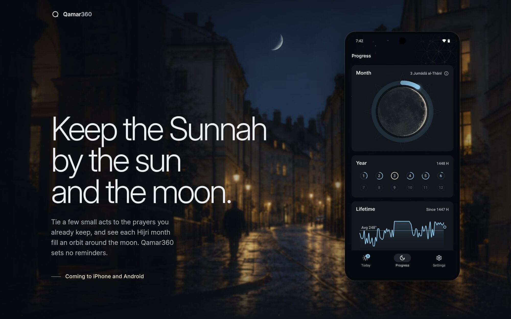
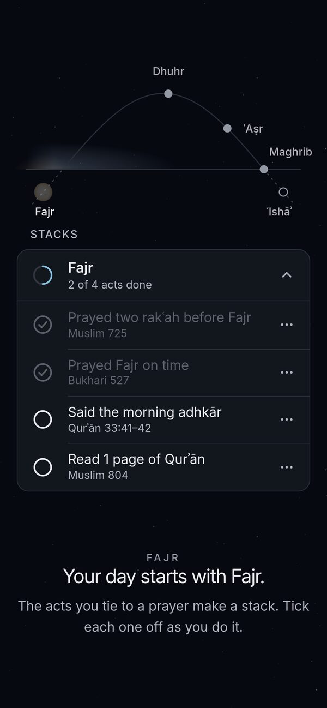
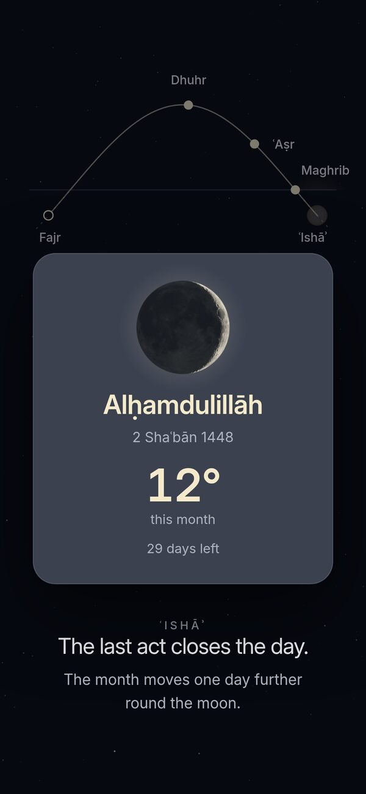
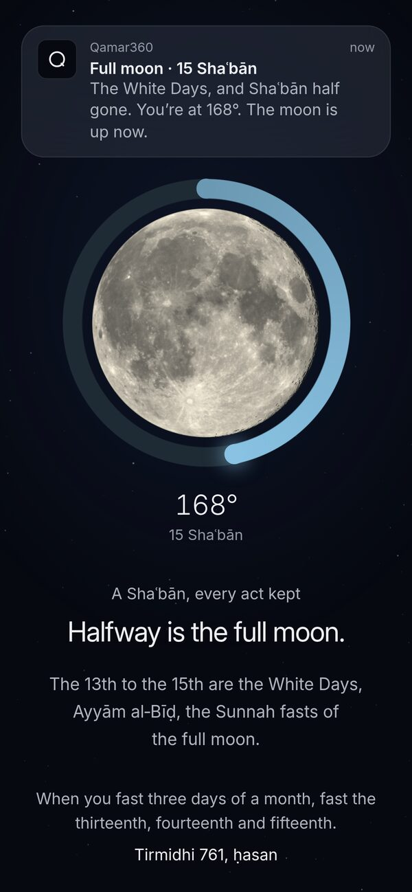
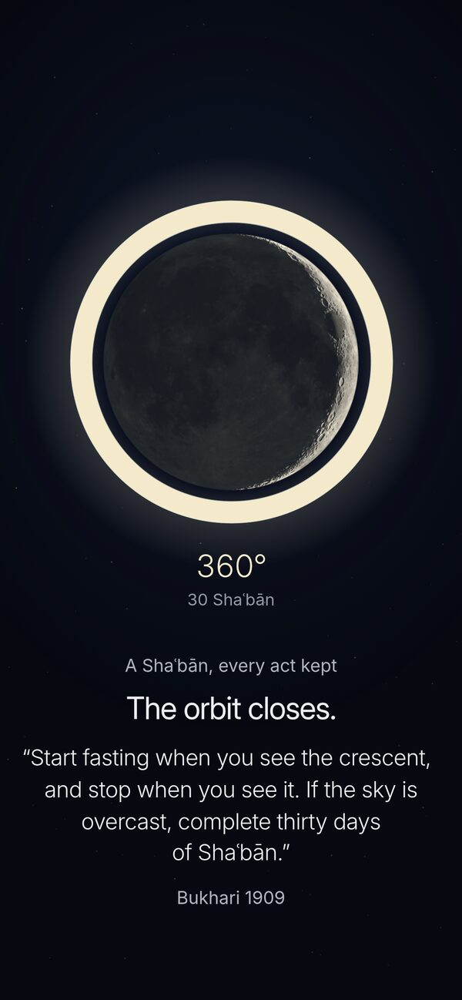

<p align="center">
  <a href="https://qamar360.com">
    
  </a>
</p>

<p align="center">
  An Expo app for iPhone and Android on Supabase that works out the sun,<br>
  the moon and the Hijri date on the phone, with its site on a Cloudflare Worker.
</p>

<p align="center">
  <a href="https://qamar360.com"><b>qamar360.com</b></a> ·
  <a href="#features">Features</a> ·
  <a href="#run-it-locally">Run it locally</a> ·
  <a href="#docs">Docs</a>
</p>

<p align="center">
  <a href="https://github.com/YunusAndreasson/qamar360/actions/workflows/verify.yml"></a>
  <a href="https://github.com/YunusAndreasson/qamar360/actions/workflows/web.yml"></a>
  <a href="LICENSE"></a>
</p>

<br>

Qamar360 is a habit app for the Sunnah. You tie a few small acts to a prayer
you already keep, tick them off after it, and each Hijri month fills an orbit
around the moon. It sets no reminders, because the prayer is the cue. It isn't
in the App Store or Google Play yet.

## Features

- **Stacks.** A few acts done straight after something you already do every
  day, such as Fajr, waking up or getting into bed. Ready-made stacks start
  from the Sunnah's own moments, and once added they're yours to reorder and
  prune.
- **Exchanges.** A good act at the moment you'd usually reach for an old
  habit, such as putting the phone away when you get into bed.
- **The orbit.** Each Hijri month is one orbit around the moon, and a month
  kept in full is 360°. A day you skip is excused rather than counted against
  you, and to-dos don't count. Twelve orbits make the year.
- **Lunar updates.** Four notifications a month, one at each quarter of the
  moon, and none for any single habit.
- **Hijri date.** It turns at your local Maghrib, on the Umm al-Qura calendar
  with up to two days' adjustment for the sighting your masjid follows. The
  week runs Saturday to Friday, and the stars behind the app are the sky over
  your time zone, so it never asks for your location.
- **Discover.** The catalog of acts, each citing its source by collection and
  number (Muslim 725, Tirmidhi 761), with the grading for a hadith outside
  Bukhari and Muslim.

There are no ads, analytics or tracking SDKs in the app.

The site plays one day and one Shaʿbān through its own ports of the app's
stack card and orbit:

<table>
  <tr>
    <td width="25%"></td>
    <td width="25%"></td>
    <td width="25%"></td>
    <td width="25%"></td>
  </tr>
  <tr>
    <td align="center"><sub><b>Stacks</b>, Fajr at 2 of 4</sub></td>
    <td align="center"><sub>The day closed, 12° into the month</sub></td>
    <td align="center"><sub><b>Lunar updates</b>, the full moon</sub></td>
    <td align="center"><sub><b>The orbit</b> at 360°</sub></td>
  </tr>
</table>

## Run it locally

The checks need Node 26 and nothing else. The tests mock Supabase, so they
don't need a `.env` either.

```sh
npm ci
npm run verify
```

`verify` runs `tsc`, ESLint with no warnings allowed, knip for dead code, a
scan for deprecated Expo and React Native APIs, and Jest.

The app itself needs a Supabase project and a
[development build](https://docs.expo.dev/develop/development-builds/introduction/),
since it doesn't run in Expo Go. Copy `.env.example` to `.env`, fill in the
project's URL and publishable key, and `npm start` serves the bundle to that
build. `supabase/migrations/` changes a base schema older than the folder, so
it can't create a fresh database on its own yet.

The site is its own pnpm project:

```sh
cd web
pnpm install --frozen-lockfile
pnpm dev      # http://localhost:3000
pnpm verify   # Vitest, tsc and the prerendered build
```

## Docs

- [AGENTS.md](AGENTS.md): checks, QA and the two designers every screen
  answers to
- [web/AGENTS.md](web/AGENTS.md): how the site is built, its photographs and
  the app screens in them
- [docs/website-plan.md](docs/website-plan.md): the site's plan, copy rules and
  decisions
- [docs/design-review-2026-09-06.md](docs/design-review-2026-09-06.md): the app
  against Don Norman and Jakob's law

## Under the hood

- [Expo](https://expo.dev) SDK 58 and React Native 0.88, with
  [Expo Router](https://docs.expo.dev/router/introduction/)
- [Supabase](https://supabase.com) for accounts and data: Postgres with
  row-level security, a private bucket for profile photos, and an Edge
  Function that deletes an account
- [React Native Skia](https://shopify.github.io/react-native-skia/) for the
  moon, a shader over NASA's Lunar Reconnaissance Orbiter map
- [astronomy-engine](https://github.com/cosinekitty/astronomy) for the sun's
  and the moon's positions and the sidereal time the stars are placed by
- [expo-notifications](https://docs.expo.dev/versions/latest/sdk/notifications/)
  for the lunar updates, scheduled on the phone
- [TanStack Start](https://tanstack.com/start) on Vite for the site,
  prerendered and served by a Cloudflare Worker

## License

[MIT](LICENSE) for the code. The name, logo, photographs and written content
are all rights reserved, and the fonts and NASA imagery keep their own
licenses; [LICENSE](LICENSE) lists the paths. Qamar is Arabic for moon, and
360 is a month kept in full.
